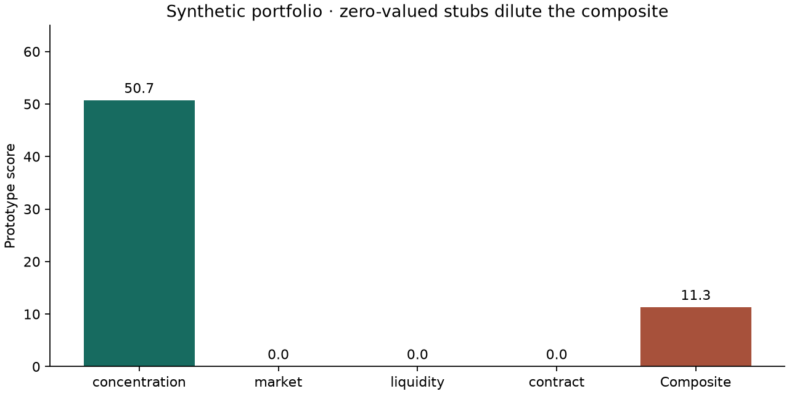

# Quant Guard prototype

Inspect text with rule-based checkers and calculate a portfolio-concentration diagnostic.

**The supplied self-test passes six scenarios.** The example portfolio scores 50.7 for concentration but only 11.3 in the composite because unfinished factors return zero; the composite is not a validated risk measure.



## Quick start

Run from the repository root with Python supporting the included syntax:

```bash
python3 -m venv .venv
.venv/bin/pip install -r requirements-dev.txt
.venv/bin/python quant_guard_clean/quant_guard/selftest.py
```

The guard core uses the standard library; the pinned runtime requirement is for the diagnostic plot. No credentials, model calls or external data are needed. `python scripts/diagnostic.py` recreates the chart from explicit synthetic holdings.

## Method

- Regex checkers detect advice-like wording, email/key-shaped text and selected injection patterns.
- Grounding checks compare number strings with supplied source text.
- Stage-specific findings map to allow, annotate, redact, block or escalate verdicts.
- The adapter defaults to shadow mode; enforcement can transform response text.
- A normalized concentration index uses portfolio value weights.
- Market, liquidity and contract scores remain zero-valued stubs.

## Results

[Saved diagnostic output](results/diagnostic.json) records every plotted score. The self-test uses fabricated text, placeholder keys and synthetic holdings. Five pytest checks cover an input block, enforced redaction, shadow behavior and equal-weight concentration. These examples do not measure real-world detection accuracy.

## What didn't work

The original README overstated live integration and risk coverage. No reproducible live API run is included. The adapter's package imports were repaired, but external application integration remains unverified. String matching is not factual verification; even a wording variant of the supplied injection example passes. Placeholder factors dilute the composite, so its low label should not guide portfolio decisions. The optional judge requires a caller-supplied function.

## Tests, structure and licence

[](https://github.com/VChahar1/Quant-guard/actions/workflows/tests.yml)

`quant_guard_clean/quant_guard/` contains checkers, policy, adapter and scoring. `tests/` contains offline checks; `scripts/` and `results/` reproduce the diagnostic. Generated bytecode is removed and ignored. Code: [MIT](LICENSE).
